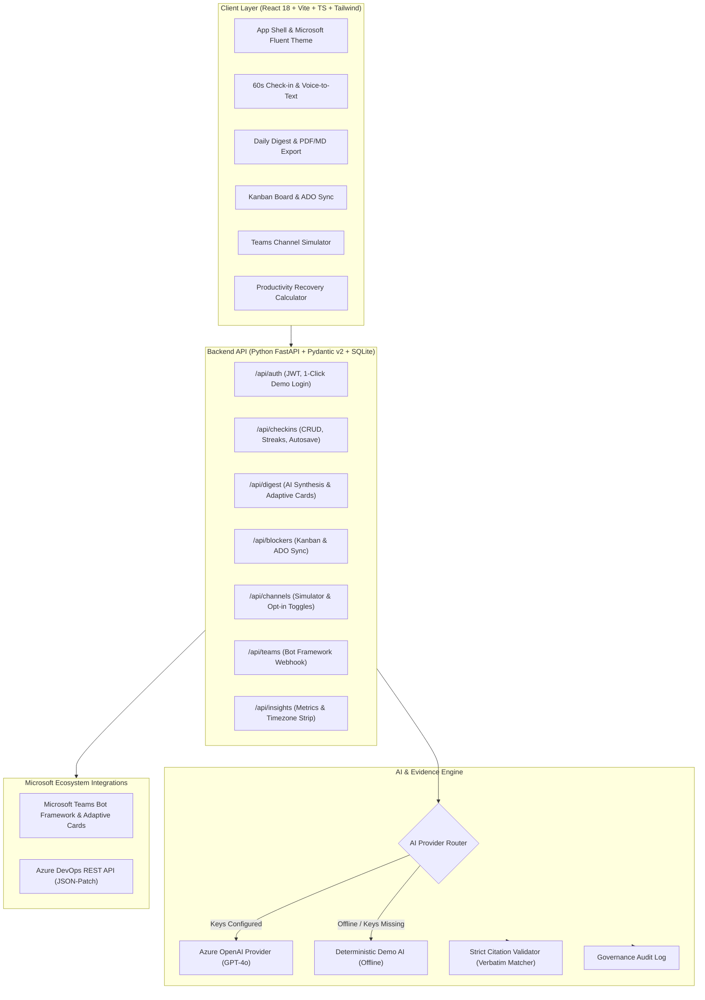

# ⚡ SyncBrief AI
> **"Async updates. Verifiable evidence. Zero status meetings."**  
> *Official Submission for the Microsoft Innovate 2026 Hackathon*

[](https://fastapi.tiangolo.com)
[](https://react.dev)
[](https://tailwindcss.com)
[](https://azure.microsoft.com)
[](https://pytest.org)

---

## 🎯 What is SyncBrief AI?
Distributed engineering teams spend **30 to 45 minutes every morning** stuck in synchronous daily standup meetings. Managers struggle to verify whether blockers are genuine or which cross-team dependency is holding up a pull request.

**SyncBrief AI replaces synchronous standup meetings with high-fidelity async signals:**
1. **60-Second Async Check-in**: Members submit updates using speech-to-text or quick bullets with autosave and streak tracking.
2. **AI Blocker Detection with Verifiable Evidence Citations (The Hero Feature)**: Every extracted blocker is strictly verified against opted-in team channels. Clickable citation badges link directly to the verbatim source message in Microsoft Teams.
3. **Executive Daily Digest**: Synthesizes team progress, identified risks, missing check-ins, and actionable unblocking recommendations for managers.
4. **Kanban Blocker Board + Azure DevOps**: 1-click sync creating Work Items flagged as `Blocked=Yes` with citation payloads.
5. **Team Velocity & Meeting Recovery**: Interactive calculator showing recovered engineering hours and dollar savings with editable assumptions.
6. **Privacy First**: Zero DM scraping. Only opted-in channels are analyzed. Full AI governance audit trail.

---

## 🏗️ Architecture Diagram



---

## 🚀 Quickstart in 3 Steps

### Option A: Non-Docker Path (Recommended for local dev)
SyncBrief AI is pre-configured with a 1-command startup script:

```bash
# Step 1: Clone the repository
git clone https://github.com/microsoft/SyncBrief.git
cd SyncBrief

# Step 2: Install dependencies & seed realistic data
make install && make seed

# Step 3: Run the app
./run.sh
# or run 'make dev'
```
- Open **http://localhost:5173** in your browser.
- Backend API docs available at **http://localhost:8000/docs**.

---

### Option B: Docker Compose Path

```bash
# Run with Docker Compose
docker compose up --build
```
- Access the web application at **http://localhost:3000** or **http://localhost:5173**.

---

## 🔑 How to Enable Real Azure OpenAI & Microsoft Teams

SyncBrief AI runs **100% offline out-of-the-box** using a deterministic mock engine so judges never experience API key failures. 

To enable live Azure OpenAI GPT-4o and Microsoft Teams webhooks:
1. Copy `.env.example` to `.env`:
   ```bash
   cp .env.example .env
   ```
2. Populate your Azure OpenAI credentials:
   ```env
   AZURE_OPENAI_ENDPOINT="https://your-resource.openai.azure.com/"
   AZURE_OPENAI_KEY="your-azure-openai-key"
   AZURE_OPENAI_DEPLOYMENT="gpt-4o"
   AZURE_OPENAI_API_VERSION="2024-08-01-preview"
   ```
3. (Optional) Connect live Microsoft Teams:
   ```env
   TEAMS_WEBHOOK_URL="https://outlook.office.com/webhook/..."
   ```
   *See [docs/teams-setup.md](file:///Users/ashutoshtripathi/Anti%20Gravity/SyncBrief/docs/teams-setup.md) for the complete Azure Bot Service setup guide.*
4. (Optional) Connect live Azure DevOps:
   ```env
   AZURE_DEVOPS_ORG="your-org"
   AZURE_DEVOPS_PROJECT="your-project"
   AZURE_DEVOPS_PAT="your-personal-access-token"
   ```
5. Restart the server. SyncBrief AI will automatically detect the keys, switch to live cloud execution, and display the **"Azure OpenAI (GPT-4o)"** badge in the UI!

---

## 🌟 Key Features Walkthrough

| Feature | Description |
| :--- | :--- |
| **Hero Verifiable Citations** | Blocker extraction that validates quotes against database records. Clicking citation badges scrolls and highlights the source chat message. |
| **60-Second Check-in** | Streamlined async check-in with Web Speech API voice-to-text, mood rating, autosave drafts, and confetti streaks. |
| **Teams Simulator** | Channel simulator (#backend, #frontend, #devops) showing real chat evidence and instant opt-in privacy toggles. |
| **Executive Daily Digest** | Automated synthesis of accomplishments, blockers, cross-team risks, missing check-ins, and suggested actions. Export to Markdown or PDF. |
| **Blocker Kanban Board** | Drag-and-drop workflow with direct Azure DevOps REST integration to create work items flagged as `Blocked=Yes`. |
| **Meeting Savings Calculator** | Interactive, editable model calculating engineering hours and dollar savings recovered from status meetings. |
| **Team Timezone Strip** | Live presence indicators showing local time, working hours, and standup streaks across India, the UK, and the US. |
| **Hallucination Detection** | 1-click test button demonstrating how the citation validator catches and rejects fake messages. |
| **AI Governance Audit Trail** | Full explainability log capturing model name, prompt versions, and input IDs. |

---

## 🧪 Automated Test Suite

Run the full backend and frontend test suite with:

```bash
# Run backend pytest (13 tests)
PYTHONPATH=. backend/.venv/bin/pytest backend/tests -v

# Run frontend Vitest (2 tests)
cd frontend && npm test -- --run
```

All 15 automated tests pass:
- Citation Validator: valid citations, fake message IDs, hallucinated quotes, and privacy opt-out enforcement.
- Blocker Extraction: hero scenario detection, "None" handling, and executive digest synthesis.
- API Endpoints: health check, 1-click demo login, check-in CRUD, blocker drag-and-drop, and Azure DevOps payload generation.
- Frontend: CitationBadge verification status and channel routing rendering.

---

## 🎬 2-Minute Judge Demo Script
Follow the step-by-step 120-second walkthrough in [docs/demo-script.md](file:///Users/ashutoshtripathi/Anti%20Gravity/SyncBrief/docs/demo-script.md).

---

## ⚠️ Known Limitations
1. **Web Speech API Browser Compatibility**: Native speech-to-text uses the W3C Web Speech API (`SpeechRecognition` / `webkitSpeechRecognition`), which is natively supported on Google Chrome, Microsoft Edge, and Safari, but may require manual permission approval on Firefox.
2. **SQLite Document Mode**: While models use JSON columns and document structures compatible with Azure Cosmos DB, the local dev instance defaults to SQLite for zero-configuration hackathon evaluation.
3. **Channel Simulator vs Live Graph API**: The built-in simulator provides an isolated, reliable demo environment for hackathon evaluation without requiring tenant admin privileges on a live Microsoft 365 tenant. Production deployment connects via the Bot Framework endpoint at `/api/teams/messages`.
